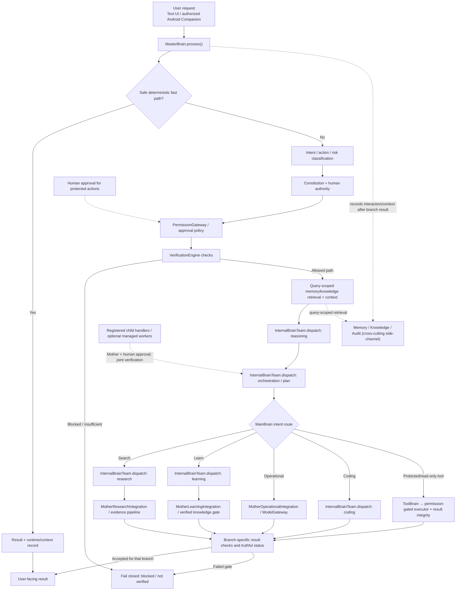

# SAHIBEX 3D Brain Architecture & Data-Flow

**Artifact status:** Documentation/diagram draft generated and source-mapped; this is not a software capability or P1–P12 completion claim.  
**Workspace:** `~/SAHIBEX`  
**Prepared:** 2026-10-23  
**Scope:** Visual architecture only. No runtime code, Constitution, permissions, tests, or roadmap status changed by creating this artifact.

## Why this exists

The 3D/exploded-view visual techniques from the referenced graphics video are presentation techniques, not SAHIBEX slash commands. Use them to explain the existing system and help reviewers follow its boundaries. A generated image is not proof that an arrow or capability exists in code.

## Source anchors inspected

- `core/brain/master_brain.py`: `MasterBrain`, `process()`, `dispatch_worker_team()`; central request entry point and orchestration.
- `core/brain/permission_gateway.py`: `PermissionGateway`; delegates decisions to the permission engine and does not execute actions or grant authority.
- `verification/verifier.py`: `VerificationEngine`; checks intent/action confidence, risk consistency, confirmation policy, and safeguards.
- `core/brain/mother_research_integration.py`: research integration entry point.
- `core/brain/mother_learning_integration.py`: learning integration entry point.
- `core/brain/operational_memory_knowledge.py`: operational retrieval integration.
- `core/brain/memory_brain.py` and `core/brain/knowledge_brain.py`: memory/knowledge components.
- `core/brain/tool_brain.py`: tool-oriented execution path.
- Existing detailed audit: `docs/ROADMAP/SAHIBEX_ARCHITECTURE_DATA_FLOW_AUDIT_2026-10-10.md`.
- Worker/child boundary caveats: `docs/ROADMAP/P5_COMMANDER_WORKER_DATA_FLOW_AUDIT_2026-10-17.md`.

These source anchors identify components; the diagram below is a reviewer-friendly high-level abstraction, not a line-by-line call graph. The separate edge-by-edge audit at `SAHIBEX_EDGE_BY_EDGE_CALL_PATH_AUDIT_2026-10-24.md` records source call sites, branch caveats, and physical-device gaps.

## Editable high-level data-flow

## Boundary notes

1. **Human authority remains final.** Protected writes, deletes, command execution, credentials, network/system changes and financial actions must stay behind the existing approval/permission controls.
2. **Verification is not execution.** Verification evaluates the proposed action/result; it does not itself perform protected actions.
3. **Research leads are not evidence by themselves.** Search discovery, snippets and generated graphics must not be represented as verified factual support. Current research answers require the existing evidence/corroboration gate.
4. **Memory and knowledge are trust boundaries.** Only the actual retrieval and lifecycle rules in code determine what can be reused as verified knowledge.
5. **Internal roles are not automatically independent processes/models.** The diagram intentionally uses “registered child handlers / internal roles” rather than implying every brain is a separate autonomous runtime.
6. **Fast paths differ.** Safe deterministic arithmetic/curated facts may return without taking the full research/tool path.
7. **Memory/knowledge is a cross-cutting context and audit side-channel**, not a specialist route whose output automatically enters result verification. Retrieval timing and exact call edges vary by path.
8. **Dashed arrows are conceptual cross-cutting relationships.** Confirm their exact implementation path before using this as a formal execution trace.

## Graphics-prompt techniques to use

These are ordinary descriptive prompt cues, not built-in slash commands.

- **Hero shot:** one clean overview centered on SAHIBEX Main Brain and the main modules.
- **Exploded view:** separate conceptual layers (input, intent/context, authority/permission, planning, specialist routes, verification/audit).
- **Assembly view:** show only code-supported directional connections; use different line styles for data-flow versus approval/control-flow.
- **Layer breakdown:** distinguish in-process internal roles from future independent Child Brains.
- **Callouts:** show source file/class names on technical versions; omit tiny labels on the cinematic overview.
- **Visual encoding:** solid arrows = primary flow; dashed arrows = cross-cutting records/approval; red = blocked/unverified; green = passed verification only when grounded in runtime evidence; grey/dashed outline = future/unverified concept.

## Recommended deliverables

- `SAHIBEX_3D_BRAIN_DATA_FLOW.svg`: scalable overview for reading/sharing.
- This Markdown file: editable Mermaid source, source anchors, boundaries and prompts.
- Optional future cinematic image: presentation only; never the source of truth for code connections.

## Verification checklist

- [x] Confirmed Termux workspace and branch context.
- [x] Read existing architecture audit and P5 worker/child audit.
- [x] Inspected the current definitions for MasterBrain, PermissionGateway and VerificationEngine.
- [x] Kept this work isolated to new files under `docs/architecture/`.
- [ ] Rendered SVG visually on the target Android device.
- [x] Independently validated primary source call-path edges; see `SAHIBEX_EDGE_BY_EDGE_CALL_PATH_AUDIT_2026-10-24.md`.
- [ ] Full regression suite: not required for documentation-only changes and not run for this artifact.
- [ ] Roadmap update: intentionally not changed; no P1–P12 gate is passed by a diagram.

## Acceptance statement

The architecture overview and source call-path audit are complete for the inspected software paths. The SVG still requires visual rendering/review on Android, and physical voice, camera/vision, and Accessibility edges remain pending until real-device acceptance. Do not label the whole SAHIBEX architecture, P1–P12, or any runtime capability COMPLETE based on this visual artifact alone.
